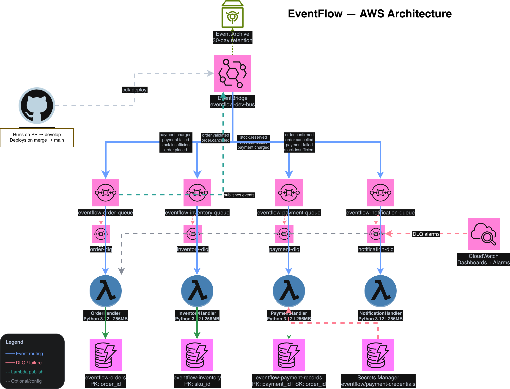

# EventFlow

[](https://github.com/jeffgrahamcodes/eventflow/actions/workflows/ci.yml)

Event-driven order processing on AWS serverless. An order goes in, and four independent services (order, inventory, payment, notification) move it through validation, stock reservation, payment and confirmation by publishing and reacting to events. None of them call each other directly.

I built it in sprints, the same way I'd run it on a team: tickets, feature branches, PRs into `develop`, ADRs for the decisions that matter. The whole stack deploys from one `cdk deploy`, and a smoke test proves the pipeline end to end against real AWS.



## How an order moves

```
order.placed ──► Order svc ──► order.validated ──► Inventory svc
                                                     │
                       stock.insufficient ◄──────────┤
                       (order cancelled)             ▼
                                              stock.reserved ──► Payment svc
                                                                    │
                                    payment.failed ◄────────────────┤
                                    (order cancelled)               ▼
                                                            payment.charged ──► Order svc
                                                                               (status: confirmed)
```

Every arrow is an EventBridge rule matching on `detail-type` and delivering to that service's SQS queue. Each queue has its own dead-letter queue (3 retries) and its own Lambda consumer.

More detail: [event flow](docs/diagrams/event-flow.md) · [sequence diagram](docs/diagrams/sequence-diagram.md)

## What's in the stack

All of it is in [`infra/lib/eventflow-stack.ts`](infra/lib/eventflow-stack.ts) (AWS CDK, TypeScript):

- **EventBridge** custom bus, 11 routing rules, and a 30-day event archive for replay
- **SQS** queue + DLQ per service
- **Lambda** (Python 3.12) handler per service, least-privilege grants to its own table and the bus
- **DynamoDB** tables for orders, inventory and payment records (on-demand billing)
- **Secrets Manager** for payment-processor credentials
- **CloudWatch** dashboard (invocations, errors, duration, queue depth, DLQ depth), an alarm on every DLQ and every handler, rolled up into two composite alarms

## Design decisions

| ADR | Decision |
| --- | --- |
| [ADR-001](docs/adr/ADR-001-event-schema-design.md) | Event schemas as Pydantic v2 models with an envelope (`event_id`, `event_type`, `version`, `timestamp`, `correlation_id`) so every event is validated at the boundary and traceable across services |
| [ADR-002](docs/adr/ADR-002-aws-service-selection-rationale.md) | EventBridge over SNS (content-based routing on `detail-type` instead of a topic per event), SQS in front of every Lambda, CDK over Terraform |

## Run it locally

Needs Python 3.12+, [uv](https://docs.astral.sh/uv/), and Node 20 if you want to synth the stack.

```bash
git clone https://github.com/jeffgrahamcodes/eventflow.git
cd eventflow
uv sync --extra dev

uv run pytest          # 49 tests
uv run ruff check .    # lint
uv run mypy src/       # types
```

The service layer in `src/eventflow/services/` runs against an in-memory bus (`bus.py`), so the business logic is testable without AWS.

## Deploy

```bash
cd infra
npm ci
npx cdk deploy

# then, from the repo root, push a real order through:
uv run python scripts/smoke_test.py
```

The smoke test publishes an `order.placed` event to the live bus and polls DynamoDB until the order, inventory and payment records all show up.

## CI/CD

- **Every PR into `develop`:** ruff lint + format check, mypy, pytest with an 80% coverage gate, and `cdk synth`
- **Every push to `main`:** `cdk deploy` via GitHub Actions

## Known gaps

I'd rather list these than have you find them:

- **Some state lives in Lambda memory.** Inventory checks read a seeded dict and the payment service tracks pending charges in a module variable. Both reset on cold start. Next step is reading stock from the inventory table with a conditional update.
- **No idempotency yet.** SQS delivers at least once, so a redelivered message can double-write. Plan is a conditional put keyed on `event_id`.
- **The Lambda order handler doesn't emit `order.confirmed` or `order.cancelled` yet.** The rules and the notification consumer exist, and the in-memory service layer does emit them; the handler just updates status.
- **Payment is a stub.** Credentials come from Secrets Manager, but there's no real processor behind them.
- **Handlers are excluded from unit-test coverage.** They're covered by the smoke test against real AWS instead.

## Tech

Python 3.12 · Pydantic v2 · boto3 · uv · ruff · mypy · pytest · AWS CDK (TypeScript) · EventBridge · SQS · Lambda · DynamoDB · Secrets Manager · CloudWatch · GitHub Actions

See [CONTRIBUTING.md](CONTRIBUTING.md) for branching and commit conventions.
